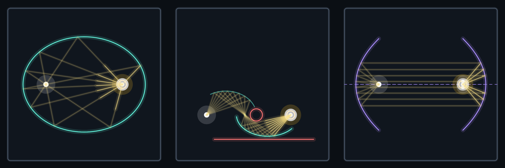
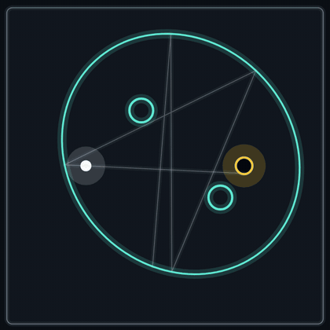
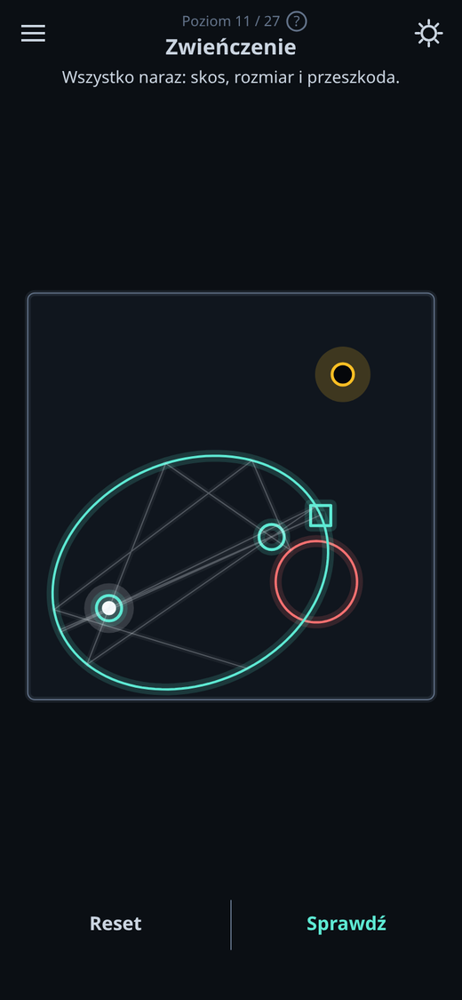
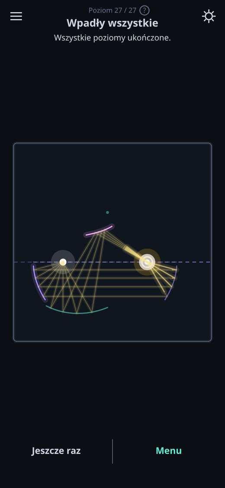
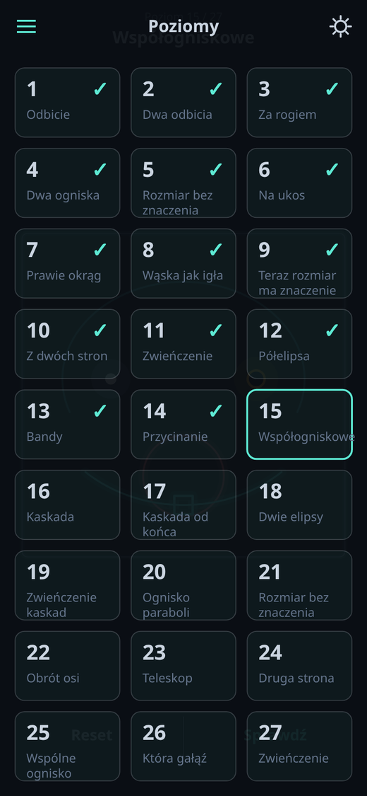

# GeoGolf

**A minigolf puzzle where you don't aim. You build the geometry that makes every shot go in.**

### [▶ Play in your browser](https://placikk.github.io/GeoGolf/)

Built for phones first (touch controls, portrait layout) but it also runs on desktop. You can install it as a PWA, and it works offline after the first visit.



---

## The idea

Most minigolf games are about aiming and luck. GeoGolf is closer to [Euclidea](https://www.euclidea.xyz/): a construction puzzle.

You get a ball, a hole and a few mirrors shaped like conic sections (ellipses, arcs, parabolas, hyperbolas). You change their shape by dragging touch handles such as foci, vertices, size and arc ends. When you press **Sprawdź** ("Check"), the game fires **8 balls at once, each in a different direction** (from stage 1 on; the warm-up stage uses a single ball). The level counts only if **all eight** reach the hole.

One lucky shot can't pass that test, but a correct construction always does. To solve a level you have to use the reflective properties of conics. An ellipse with one focus on the ball and the other on the hole sends every ball into the hole. A parabola turns a fan of shots into a parallel beam. A hyperbola redirects rays aimed at one focus toward the other. Later levels chain these into cascades, where one mirror's focus is the next mirror's source.

<p align="center">
  
</p>

Every path from one focus of an ellipse to the other via the curve has the same length (2a), and balls move at a constant speed. So the eight balls also arrive at the same instant. Nothing is faked: the convergence in the animation is the geometry itself.

**27 levels in 4 stages**, each stage adding one mechanic:

| Stage | Levels | What you learn |
|---|---|---|
| 0 | 3 | Billiards with a flat mirror (one ball, one direction) |
| 1 | 8 | Ellipses: foci, size invariance, obstacles that narrow the valid sizes |
| 2 | 8 | Elliptical arcs and cascades: one mirror's focus feeds the next |
| 3 | 8 | Parabolas and hyperbolas in two-mirror "optical systems" |

The first level of each new mechanic opens with a one-sentence rule card. Its small diagrams are traced by the real engine. The card states the rule, and the levels make you work out how to apply it.

<p align="center">
  
  
  
</p>

---

## Under the hood

The game is a small exact ray tracer for conic sections. There is no physics engine.

- **One representation for every curve.** Lines, circles, ellipses, parabolas and hyperbolas are all stored as the general quadratic form `Ax² + Bxy + Cy² + Dx + Ey + F = 0`. The type is never stored as a field. It is computed from the discriminant `B² − 4AC`, and a line is simply the case `A = B = C = 0`. So walls, mirrors and obstacles all go through the same code path: [`src/core/conic.ts`](src/core/conic.ts).
- **Exact ray–conic intersection.** Substituting the ray `P + t·d` into the form gives a quadratic in `t`. It is solved with the numerically stable form `q = −½(b + sign(b)·√Δ)`, `t₁ = q/a`, `t₂ = c/q`, which avoids cancellation on very thin ellipses. There is a separate linear branch for `a ≈ 0` (degenerate curves, or rays parallel to an asymptote), and an ε-threshold so a ball sitting on a mirror after a bounce doesn't hit it again at `t ≈ 0`: [`src/core/intersect.ts`](src/core/intersect.ts).
- **Reflection from the gradient.** The normal is the gradient of the form, `(2Ax + By + D, Bx + 2Cy + E)`, and the reflection is `d′ = d − 2(d·n̂)n̂`. Three lines of code work for every curve type: [`src/core/reflect.ts`](src/core/reflect.ts).
- **Partial curves.** Elliptical arcs and segments are clipped by which side of a chord a point lies on. That test fails for hyperbolas, because the other branch lies on the same side, so parabolas and hyperbolas use a parameter range in the curve's own frame, which also picks the branch: [`src/core/piece.ts`](src/core/piece.ts), [`src/core/frame.ts`](src/core/frame.ts).
- **Arcs defined by arc length.** A player's arc is stored as a midpoint plus a length measured along the curve, using a cumulative length table with an exact piecewise-linear inverse. When you resize the ellipse, the mirror keeps its length instead of growing, which closes off a whole class of "solve the cascade with one big ellipse" exploits: [`src/levels/arc.ts`](src/levels/arc.ts), [`src/levels/span.ts`](src/levels/span.ts).
- **Deterministic proof.** The eight launch directions are fixed and the tracing is pure, so the same layout always gives the same result regardless of frame rate: [`src/core/trace.ts`](src/core/trace.ts), [`src/core/verify.ts`](src/core/verify.ts).

**Why no game engine?** A physics engine simulates rigid bodies within tolerances, but this game needs the *exact* intersection of a ray with a curve. A focus that is slightly off must make balls miss, or the puzzle teaches something false. Most of the work with an engine would go into fighting it. The entire geometric core is about 400 lines of TypeScript with no dependencies.

---

## Engineering

- **Zero runtime dependencies.** TypeScript in strict mode, Canvas 2D, Vite. The production bundle is about 15 KB gzipped.
- **691 tests** in Vitest (26 files), including:
  - **property tests** of the math itself, e.g. for 300 random ellipses and random directions, the path focus → mirror → focus must be exactly `2a`, and the reflected ray must aim at the other focus;
  - **level tests:** for every level, the stored solution must solve it, the starting position must not, and a focus nudged off target by the snap radius must fail (so the hole tolerance can't pass sloppy solutions);
  - **a bundle budget:** the test builds the production bundle, fails above **100 KB gzip**, and checks that the build registers the service worker;
  - **architecture rules:** a layering test makes sure `src/core` imports nothing outside itself, and another test bans `shadowBlur`, which is slow on phones (the glow is drawn as two strokes instead).
- **Layered design:** `core/` (pure geometry, runs in Node) → `levels/` (levels are data, not code) → `render/` → `ui/`.
- **Offline PWA** with a hand-written service worker: network-first for the page so updates arrive immediately, cache-first for hashed assets. All paths are relative, so the same build works at `/` and at `/GeoGolf/`.
- **CI/CD:** GitHub Actions runs the tests, builds the game and deploys it to GitHub Pages on every push to `master` ([`.github/workflows/deploy.yml`](.github/workflows/deploy.yml)).

---

## How it was built

I (Michał Plata) built GeoGolf with an AI-agent workflow in [Claude Code](https://claude.com/claude-code). I designed the game, the progression and every level, and made the architecture calls: the single quadratic form, no engine, levels as data. For each stage I wrote or approved a design spec and an implementation plan. Agents then implemented them test-first and kept decision logs of every choice they made on their own, so I could review it and overrule it if needed. Those documents are all in [`docs/superpowers/`](docs/superpowers/) (in Polish): 7 specs, 7 plans and 4 decision logs.

---

## Run locally

Requires Node.js 20.19+ or 22.12+ (CI uses 22).

```bash
npm install
npm run dev      # dev server with hot reload
npm test         # full test suite (also builds the bundle for the size-budget test)
npm run build    # type-check + production build into dist/
npx vite preview # serve the production build
```

To check one level's stored solution from the command line: `npx vite-node scripts/sprawdz-poziom.ts <level-id>`.

---

## Roadmap (ideas)

From the design spec, not yet implemented:

- **Level editor with sharing by link.** Levels are already plain data, so an editor is a second interface to the same model. Possibly with a community tab and automatic checks that shared levels are solvable.
- **Black holes:** curved ball paths, which need numerical integration, so a new engine.
- **Non-Euclidean boards**, e.g. a torus with wrap-around topology.

---

*The game's interface is in Polish. Code comments and design documents are in Polish too.*
